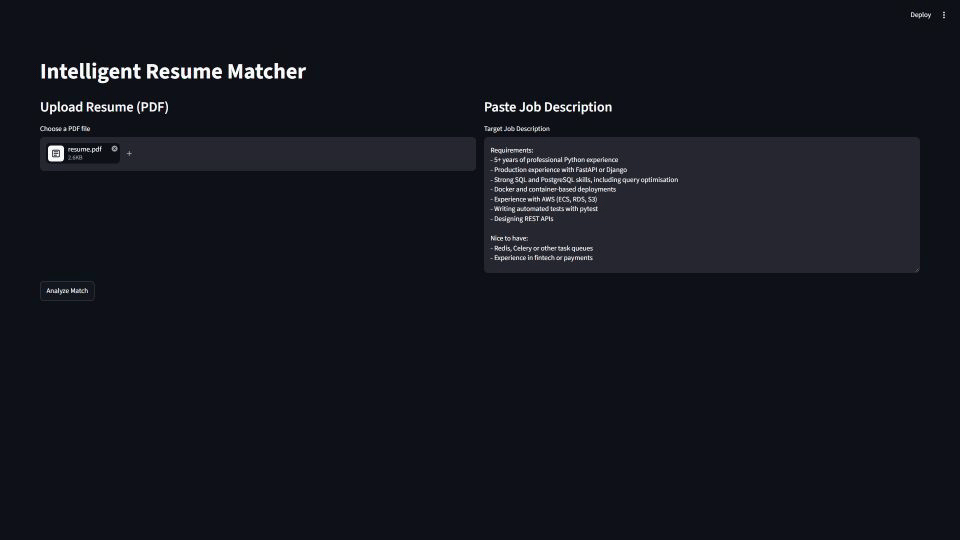
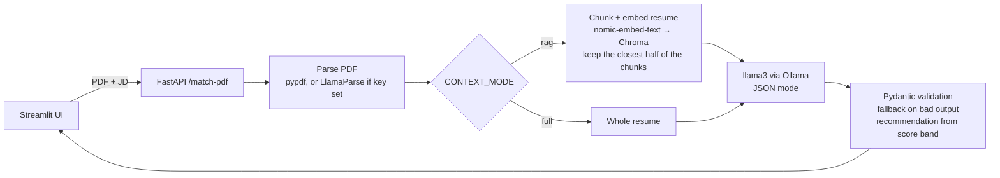

# Resume Matcher

Upload a resume PDF and paste a job description. A local LLM scores the match (0–100), lists missing skills, and gives a hiring recommendation, all running on your machine via Ollama.

The interesting part isn't the app, it's the [**evaluation**](#evaluation): I labelled a set of resume/JD pairs and measured whether the scores are any good, and whether retrieval (RAG) actually helps on a document as short as a resume.

**Result:** on 18 synthetic pairs, a scoring rubric in the prompt halved the model's over-scoring (+13.9 → +6.6) and raised recommendation accuracy from 54% to 70%. Then I [tested it on 98 real resume/job pairs](#real-resumes), and the synthetic eval turned out to be far too easy: the model over-scores real candidates by about 43 points and ranks them only loosely (correlation 0.47). A third prompt that scores from a requirement checklist cut that over-scoring in half (+20.4) and raised recommendation accuracy from 36% to 49%, but missed my adoption rule on correlation by 0.02, so it's an option, not the default yet. The app isn't reliable on real resumes yet.

<!--  -->


## How it works



- **Structured output:** the LLM runs in Ollama's JSON mode and the response is validated against a Pydantic schema (`score` 0–100, recommendation is one of `Hire / Interview / Review / No Hire`). Invalid output returns a safe fallback instead of a 500. Answers are capped at 1,024 tokens, after one real-resume eval call kept generating for over an hour.
- **Retrieval:** the resume is chunked into ~300-character line windows, embedded, and the half of the chunks closest to the job description becomes the LLM context, kept in resume order. The vector store is in-memory and each resume is deleted after its request, so nothing is stored.
- **Parsing:** local `pypdf` by default (first 10 pages), so nothing leaves your machine. Set `PDF_PARSER=llamaparse` plus `LLAMA_CLOUD_API_KEY` to use LlamaParse for better markdown on complex layouts. This sends the PDF to LlamaCloud, and if LlamaParse fails it falls back to `pypdf`. Uploads over 5 MB are rejected.

## Quickstart

```bash
docker compose up --build
```

Open http://localhost:8501. The first start downloads the Ollama image and the `llama3` and `nomic-embed-text` models (~13 GB in total) into Docker.

Inside Docker, Ollama runs on CPU by default, so one match takes about 2–3 minutes. With an NVIDIA GPU, add `gpus: all` to the `ollama` service in `docker-compose.yml`, or use the [non-Docker setup](#without-docker) with a host Ollama.

Settings from the table below pass through from your shell, for example `PROMPT_VERSION=v1 docker compose up`. To use LlamaParse in Docker, add the opt-in file, which is the only way the API key reaches the container: `docker compose -f docker-compose.yml -f docker-compose.llamaparse.yml up`.

### Without Docker

From the repo root:

```bash
ollama pull llama3
ollama pull nomic-embed-text
pip install -r requirements-dev.txt -r requirements-frontend.txt
uvicorn main:app --app-dir backend --reload
```

Then, in a second terminal:

```bash
streamlit run frontend/app.py
```

### Configuration

| Variable | Default | |
|---|---|---|
| `CONTEXT_MODE` | `rag` | `rag` (retrieved chunks) or `full` (whole resume) |
| `PROMPT_VERSION` | `v2` | `v2` (scoring rubric, won the eval), `v1` (original prompt) or `v3` (requirement checklist, score computed in code; best on real resumes but ~3× slower, see [Real resumes](#real-resumes)) |
| `LLM_MODEL` | `llama3` | any Ollama chat model |
| `EMBED_MODEL` | `nomic-embed-text` | any Ollama embedding model |
| `PDF_PARSER` | `pypdf` | `pypdf` (local) or `llamaparse` (sends PDFs to LlamaCloud) |
| `LLAMA_CLOUD_API_KEY` | unset | needed when `PDF_PARSER=llamaparse` |

## Evaluation

[`eval/data/cases.csv`](eval/data/cases.csv) contains 18 hand-labelled pairs: 8 fictional resumes of realistic one-page length (~1,500 characters) × 4 job descriptions, covering clear matches, clear mismatches and borderline cases. Each label is an expected score and recommendation.

```bash
python eval/run_eval.py
```

This runs every pair 3 times in three configurations, `rag:v1` (baseline), `full:v1` (does RAG help?) and `rag:v2` (does the rubric prompt fix over-scoring?), and writes [`eval/results.md`](eval/results.md). Runs with other `--configs` or `--runs` go to `results-partial.md` instead. Every run also saves its raw scores (`results.json` or `results-partial.json`), so after editing labels, `python eval/run_eval.py --rescore` (or `--rescore results-partial`) recomputes the report in seconds without calling the model.

The v2 rubric uses the same score bands as the labels (Hire 85+, Interview 50–84, Review 35–49, No Hire below 35), so it teaches the model the hiring policy it's graded on. That's what calibration means here. Its example candidate is deliberately not an eval case. The rule was to adopt v2 only if it lowered the bias without lowering correlation or recommendation accuracy. It improved all three, so it is now the default.

Metrics:

- **Score bias:** average of model score minus label. Positive means the model over-scores.
- **Avg context chars:** how much of the resume the LLM actually saw, which shows whether RAG dropped anything.
- **MAE / correlation:** how far the mean score is from my label, and whether it ranks candidates the same way.
- **Recommendation accuracy:** exact match with the labelled recommendation, both for the model's own answer and for the recommendation derived from its score (what the API returns).
- **Run-to-run stdev:** how much the score moves when you ask the same question again.
- **Failed calls:** invalid LLM output. These are counted separately and kept out of the other metrics.

### Results

llama3 (8B), 18 cases × 3 runs per config, 0 of 162 calls failed. Full table: [`eval/results.md`](eval/results.md).

| Config | Avg context chars | Score bias | MAE vs label | Correlation | Rec. accuracy (model) | Rec. accuracy (from score) | Run-to-run stdev |
|---|---|---|---|---|---|---|---|
| rag:v1 (baseline) | 969 | +13.9 | 15.9 | 0.91 | 54% | 61% | 6.8 |
| full:v1 | 1596 | +15.2 | 17.8 | 0.88 | 50% | 54% | 4.3 |
| **rag:v2 (rubric, now default)** | 969 | **+6.6** | **10.9** | **0.93** | **70%** | 63% | 6.9 |

**What I took from it:**

- **The model ranks well but over-scores.** With the original prompt, correlation was about 0.9, but scores sat 14–15 points above my labels on average, worst for mismatches: a data analyst got 55 for an NLP role in full mode against my label of 10.
- **A scoring rubric halved the bias, and that replicated.** Giving the model the same score bands my labels use cut the bias from +13.9 to +6.6 and MAE from 15.9 to 10.9, and raised correlation (0.93) and recommendation accuracy (54% → 70%), so v2 is the default. An earlier full run showed the same pattern (+10.8 → +5.5). It still over-scores Python-heavy candidates for the ML role (64 against a label of 30), which is the obvious next target.
- **RAG didn't hurt, and may help a little.** With 39% less context, RAG had lower bias and MAE than the full resume in both runs, with an equal or slightly higher correlation. My guess is that the whole resume gives the model more loosely related keywords to talk itself into a higher score. With 18 cases and a run-to-run stdev of 4–7 points, that's suggestive, not conclusive.
- **RAG has a visible failure mode.** In a manual test it reported Redis, Celery and fintech as "missing" for a candidate whose resume lists all three, because those lines were in chunks it didn't retrieve.
- **A result that didn't replicate.** The model's recommendation contradicts the band of its own score about 28% of the time (for example, scoring a candidate 73 and saying "Review"). In the first run, deriving the recommendation from the score raised accuracy from 59% to 74%. In this run it went the other way (70% model, 63% derived). With 54 decisions per config, a 10-point gap is about 5 decisions, so neither run shows a real accuracy difference. The API still derives the recommendation from the score, because then the two can never contradict each other. That's a consistency choice, not an accuracy gain.
- **Structured output held up.** Every call returned valid JSON within the schema's ranges.

### Real resumes

The synthetic set was written by me, so it could be too easy. To check, I ran the same three configs on 98 real pairs: 40 real resumes (25 collected, 15 from a public Kaggle resume dataset) against 6 real public job postings, mixing intended matches, borderline cases and mismatches. I labelled every pair blind, in a [small labelling app](eval/label_app.py) that hides names, contact details and personal details, so the labels judge skills and experience only. The resumes, postings and labels are personal data, so they're not in this repo; the harness reads them with `--cases/--resumes/--jds/--out`, and PDFs go through the app's own local parser.

llama3 (8B), 98 cases × 3 runs per config. 1 of 882 calls failed: it ran away and was stopped after an hour.

| Config | Avg context chars | Score bias | MAE vs label | Correlation | Rec. accuracy (model) | Rec. accuracy (from score) | Run-to-run stdev |
|---|---|---|---|---|---|---|---|
| rag:v1 | 2564 | +46.3 | 47.7 | 0.41 | 26% | 30% | 5.7 |
| full:v1 | 4958 | +48.5 | 49.6 | 0.39 | 23% | 32% | 4.9 |
| **rag:v2 (default)** | 2564 | **+42.9** | **43.8** | **0.47** | **30%** | **36%** | 6.1 |

- **The synthetic eval overstated quality.** Bias went from +6.6 to +42.9 and correlation from 0.93 to 0.47 for the same config. My synthetic resumes were clean, obvious matches or obvious mismatches; real ones are messier and mostly partial fits.
- **Over-scoring is the main failure.** I labelled 76 of the 98 pairs No Hire (mean label 15). The model gave those pairs about 51–58 on average, which lands in Interview. It does separate them from good fits, which average about 80, but it barely tells Hire, Interview and Review apart.
- **The rubric still wins, by less.** rag:v2 is best on every metric, as on the synthetic set, but a few points of bias don't matter when the bias is 43. RAG versus full resume makes little difference again.
- **Deriving the recommendation from the score did better here** (36% vs 30% for rag:v2, and better in every config), on 294 decisions per config instead of 54.
- **Caveats:** one labeller, a label set skewed towards No Hire, and only 6 postings, so pairs that share a posting aren't independent.

#### v3: score from a requirement checklist

v2 lets the model pick the number, and it picks generous ones. v3 never asks for a score: the model lists the job's core requirements (at most 8, including years or level) and marks each `met`, `partial` or `missing` with a few words of evidence. The code scores met = 1, partial = 0.5, missing = 0 as a percentage and derives the recommendation from that. The rule, set before running it: adopt v3 if it lowers bias and MAE against rag:v2 without lowering correlation.

rag:v3, same 98 real pairs, 1 run (v3 calls take about 3× as long, so 3 runs would have taken over 15 hours):

| Config | Score bias | MAE vs label | Correlation | Rec. accuracy | Failed calls | Sec per LLM call |
|---|---|---|---|---|---|---|
| rag:v2 (3 runs) | +42.9 | 43.8 | **0.47** | 36% (from score) | 1 of 294 | 90 |
| rag:v3 (1 run) | **+20.4** | **28.3** | 0.45 | **49%** | 1 of 98 | 247 |

- **It halved the over-scoring.** Pairs I labelled No Hire dropped from about 51 to 31 on average, and No Hire is now the model's most common call instead of Interview.
- **It overshoots the other way on strong fits.** Pairs labelled Hire average 60 (label 90): a few `partial` verdicts pull a good candidate down to Interview. The synthetic set showed the same thing (bias −8.4, MAE 13.7 against v2's 10.9).
- **Correlation didn't improve** (0.45 against 0.47), so by the rule v3 isn't the default. A 0.02 gap from one run is within noise, but the rule exists so I don't argue my way past it after seeing the numbers. It's available as `PROMPT_VERSION=v3`.
- **The first try failed for a boring reason.** At the 512-token answer cap, 5 of the first 13 checklists were cut off mid-JSON, because real postings list more requirements. The cap is now 1,024, and the run was restarted from scratch. One answer used a status outside the three allowed values and was counted as failed.

**Next steps:** fix v3's harshness on strong fits (count `partial` higher, or let seniority gaps count as partial rather than missing), then run it 3 times to settle the correlation question. A stronger model would show how much of the remaining gap is model size. Then stop asking v1/v2 for a recommendation the API replaces anyway.


## Development

```bash
pip install -r requirements-dev.txt
ruff check .
pytest
```

Tests stub out Ollama and the PDF parser, so they run without a model. CI runs both on every push.

## Limitations

- Labels are one person's judgement, on 18 synthetic pairs and 98 private real pairs: good for comparing configurations, not a benchmark.
- On real resumes the scores are too high to use as-is (see [Real resumes](#real-resumes)).
- llama3 runs at Ollama's default temperature, so scores vary between runs (see the stdev column).
- The Streamlit UI is a thin demo client; the API is the product.
